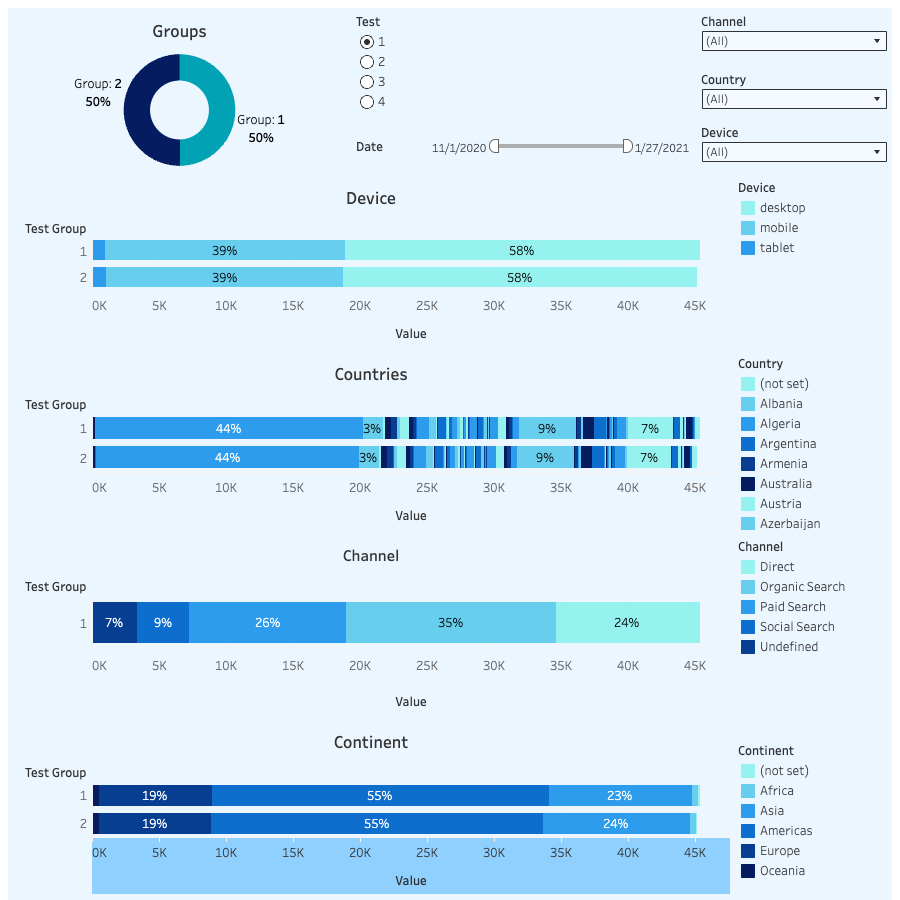

# A/B Testing: Checkout Funnel Experiments

**Statistical evaluation of four A/B tests on an e-commerce checkout funnel: SQL in BigQuery, two-proportion z-tests in Python, and a Tableau dashboard for exploring the results.**

[](https://public.tableau.com/views/ABTest_17675349607140/ABTest)
[](https://colab.research.google.com/github/kasianeno/User-Experimentation-and-A-B-Test-Dashboard/blob/main/AB_project.ipynb)


[](https://public.tableau.com/views/ABTest_17675349607140/ABTest)

## Goal

Earlier, significance was checked by hand in online calculators. This project replaces that with a reproducible pipeline: one SQL query prepares the data, a Python script tests every metric in every experiment at once, and a dashboard shows where the changes are significant.

## Results

Each metric is the share of sessions with the event: `events / unique sessions` per group. Uplift is group B relative to group A. Significance is a two-proportion z-test at α = 0.05; **bold** marks a significant change.

| Test | Sessions (A / B) | add_payment_info | add_shipping_info | begin_checkout | new_account |
|---|---|---|---|---|---|
| 1 | 45,362 / 45,193 | **+12.5%** (p < 0.001) | **+6.6%** (p = 0.009) | **+6.7%** (p = 0.003) | −3.4% (p = 0.12) |
| 2 | 50,637 / 50,244 | +3.6% (p = 0.21) | +1.7% (p = 0.48) | +2.0% (p = 0.34) | +1.2% (p = 0.56) |
| 3 | 70,047 / 70,439 | +1.5% (p = 0.52) | −2.6% (p = 0.16) | **−3.4%** (p = 0.012) | −1.1% (p = 0.52) |
| 4 | 105,079 / 105,141 | −3.5% (p = 0.12) | −3.4% (p = 0.07) | **−2.4%** (p = 0.046) | **−3.4%** (p = 0.018) |

### Recommendations

- **Test 1: roll out.** The variant lifts three consecutive funnel steps, and the effect on `add_payment_info` (+12.5%) is strong enough to hold even after a Bonferroni correction for all 16 comparisons.
- **Test 2: no effect.** No metric moved significantly; keep the control.
- **Tests 3 and 4: reject.** Both variants reduce the share of sessions that begin checkout, and Test 4 also reduces new account sign-ups.

## How it works

1. **SQL ([`testing-tool.sql`](testing-tool.sql)).** Joins A/B assignments with sessions, session parameters, orders, events and accounts, and returns one long table: session × test × group × event, with country, device, continent and channel attached. The same table feeds both the Python analysis and the Tableau dashboard.
2. **Python ([`AB_project.ipynb`](AB_project.ipynb)).** Loops over every test and metric, computes conversion for each group, uplift, z-statistic and p-value with `statsmodels.stats.proportion.proportions_ztest`, and collects everything in one results table.
3. **Tableau.** Shows the split of each test group by device, country, channel and continent, with filters by test, date, channel, country and device.

## Repository structure

```
.
├── testing-tool.sql     # BigQuery query that builds the A/B dataset
└── AB_project.ipynb     # significance testing for all tests and metrics
```

The source data comes from a training BigQuery dataset and is not included in the repository.

## Tools

SQL (Google BigQuery) · Python (pandas, NumPy, statsmodels) · Google Colab · Tableau Public

## Next steps

- **Segment-level results.** The notebook's device and country breakdowns divide segment event counts by all sessions in the test, so they show event volume rather than conversion. Recomputing them with each segment's own sessions as the denominator would make per-device and per-country uplift comparable.
- **Multiple comparisons.** With 16 tests at α = 0.05, about one false positive is expected by chance; reporting adjusted p-values (Bonferroni or Benjamini–Hochberg) would make the conclusions for Tests 3 and 4 more robust.
- **Effect sizes with confidence intervals** alongside p-values, to show the plausible range of each uplift.
